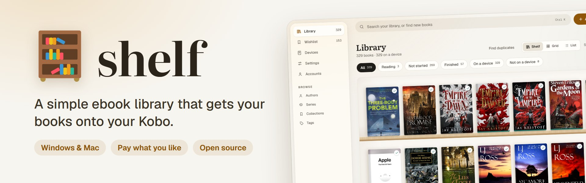
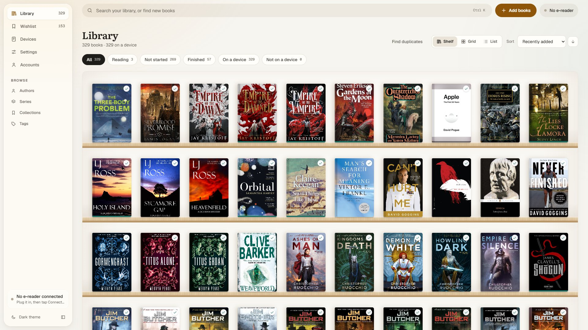
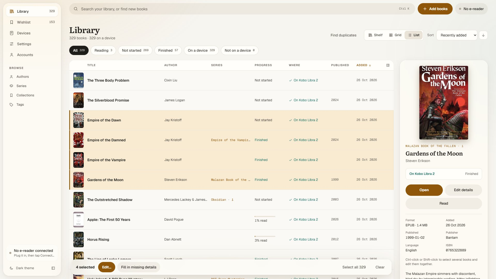
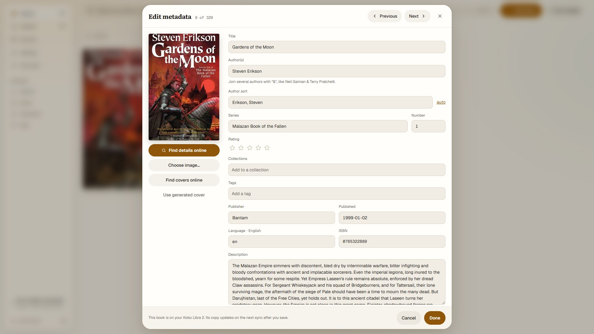
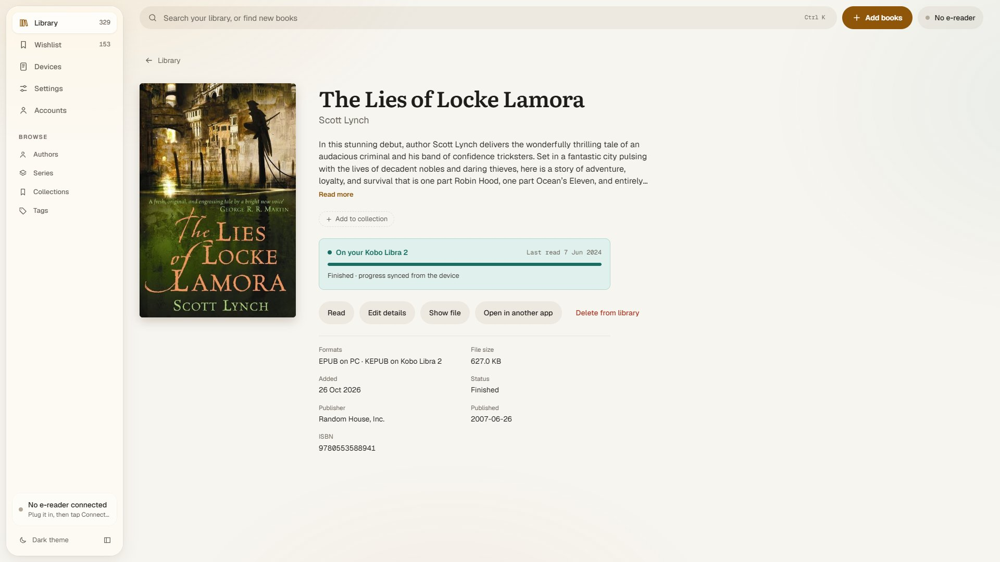

<p align="center">
  
</p>

<p align="center">
  <a href="https://alexwaddell97.itch.io/shelf"></a>
  <a href="https://github.com/alexwaddell97/shelf/releases/latest"></a>
  <a href="LICENSE"></a>
</p>

# Shelf

I made Shelf because I wanted something simpler than calibre for getting books onto my Kobo.

Drop your EPUBs in and Shelf sorts out the covers and details. Plug your Kobo in and it sends them over, converted to kepub, and brings your reading progress back. It runs on Windows, macOS and Linux, and your library stays on your computer.

> Shelf is young. If something's broken or confusing, please [open an issue](https://github.com/alexwaddell97/shelf/issues/new/choose).

## What it does

**Your books on shelves.** A bookcase, a cover grid or a table you can sort by any column. Filter by what you're reading or what's on your e-reader, search as you type, and browse by author, series, collection or tag.

<p align="center"></p>

**Lots of books at once.** Ctrl-click or Shift-click books in the list to set an author or series (numbered in order), add tags and collections, set a rating, fill in missing details or send them all to your Kobo.

<p align="center"></p>

**Tidy details.** Edit titles, authors, series, tags, covers and the rest, stepping from book to book with Previous and Next. Missing a cover or a description? Look the book up on Open Library and pick which fields to take, or fill the gaps for your whole library in one go. Shelf can also find duplicate copies and merge them.

<p align="center"></p>

**Your Kobo in sync.** Plug it in and Shelf sends whatever's waiting, converted to kepub for faster page turns and Kobo's reading stats. The conversion is built in, so there's nothing else to install. Your progress comes back the same way, and your edits reach the copy on the device on the next sync.

<p align="center"></p>

**And the rest.** Imports your calibre library (read-only, so you can keep using both) and your Goodreads export. Picks up new ebooks from your Downloads folder. Opens `.epub` files when you double-click them. Searches Open Library for new books, adds free ones from Project Gutenberg in one click, and keeps a wishlist that ticks itself off when a book arrives. A dark theme, too.

<p align="center"></p>

## Installing

Download Shelf from [itch.io](https://alexwaddell97.itch.io/shelf), where you can pay what you like (including nothing), or from the [latest release](https://github.com/alexwaddell97/shelf/releases/latest) here. Once it's installed, Shelf tells you when there's a new version and updates itself.

The downloads aren't code-signed yet, so your computer may warn you the first time:

- **Windows:** "Windows protected your PC". Click **More info**, then **Run anyway**.
- **Mac:** open the `.dmg` and drag Shelf into Applications. If it won't open, go to **System Settings → Privacy & Security** and click **Open Anyway**.
- **Linux (experimental):** make the AppImage executable (`chmod +x Shelf_*.AppImage`) and run it.

## E-readers

| Device | Status | Sends |
| --- | --- | --- |
| Kobo (Clara, Libra, Sage, Elipsa, …) | Supported | kepub (built in) |
| PocketBook | Planned | EPUB |
| Tolino | Planned | EPUB |
| Kindle | Planned (needs calibre for conversion) | AZW3 |
| Boox and other Android readers | Planned | EPUB |
| KOReader | Planned | EPUB |

Drivers live in [`src-tauri/src/devices/`](src-tauri/src/devices), and adding one is a good first contribution. What's coming next is on the [roadmap](ROADMAP.md).

## Privacy

No account, no tracking, no analytics. Shelf only goes online when you ask it to: searching for books (Open Library and Gutendex), looking up a book's details (sending Open Library its title, author and ISBN), downloading a free book from Project Gutenberg, or opening a store link in your browser. It also checks this project's latest GitHub release for a new version when it starts and every few hours. Nothing about you or your library is sent.

## Where things are kept

- **Your books:** `Documents/Shelf Library/<Author>/<Title>.epub` by default.
- **The library database, covers and device backups:** the app data folder (`%APPDATA%\org.shelfapp.shelf` on Windows, `~/Library/Application Support/org.shelfapp.shelf` on macOS, `~/.local/share/org.shelfapp.shelf` on Linux).
- **On a Kobo:** books go into a `Shelf` folder. Before each sync, Shelf saves a copy of the device's `KoboReader.sqlite` under `device-backups/` in the app data folder.

## Building it yourself

You'll need [Rust](https://rustup.rs) (stable), [Node.js](https://nodejs.org) 22 or newer, and the [Tauri prerequisites](https://tauri.app/start/prerequisites/) for your system.

```bash
npm install
npm run tauri dev      # run it with hot reload
npm run tauri build    # make an installer for your system
```

Before sending a pull request, run the checks:

```bash
npm run check
cargo test --manifest-path src-tauri/Cargo.toml
```

[CONTRIBUTING.md](CONTRIBUTING.md) has more on how the code is laid out.

<details>
<summary>Making a release</summary>

Push a version tag (`git tag v0.2.0 && git push origin v0.2.0`) and GitHub Actions builds the Windows, macOS and Linux installers into a draft release, with the `latest.json` that installed copies check for updates. It needs the updater's private key as the repository secret `TAURI_SIGNING_PRIVATE_KEY`. When publishing the draft, untick **Set as a pre-release** and tick **Set as the latest release**, or installed copies won't see the update.

For a Windows-only build on your own PC, `npm run release` (add `-- --notes-file notes.md` for release notes) builds a signed installer and `latest.json`, then prints the commands to publish them. The key is kept outside the repository, in `~/.tauri/shelf-updater.key` by default. Without it, copies already out there can't be sent updates.

</details>

## Reporting a bug

[Open an issue](https://github.com/alexwaddell97/shelf/issues/new/choose) and say what you did, what you expected and what happened instead. Your system and Shelf's version (in **Settings**, under **About Shelf**) help a lot. Ideas are welcome there too.

## Licence

Shelf is free software, released under the [GNU General Public License v3.0 or later](LICENSE). It's free and will stay free; if it saves you some time, [paying what you like on itch.io](https://alexwaddell97.itch.io/shelf) keeps new versions coming.
